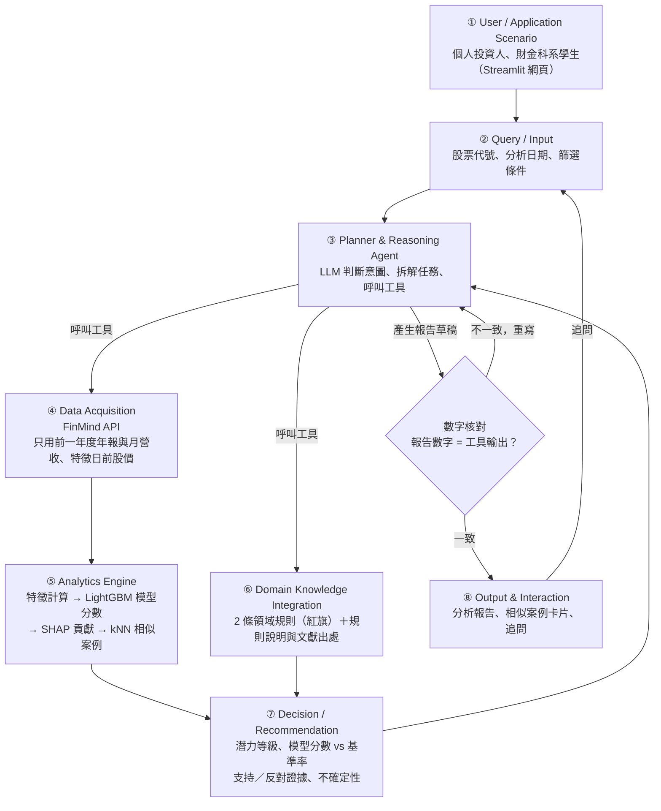

# Multibagger Scout 系統設計文件

**版本 v0.6（2026-11-09 這週）｜最後更新 2026-11-10**（歷次修改見第 13 節 Change Log）

> 本文件的目的：即使原開發者不在，下一位開發者仍能**理解、執行、驗證並繼續開發**本系統。
>
> **目前狀態：提案階段。** 已實作完成「資料可行性驗證」、「全市場資料收集」與「資料管線 Demo」。標示「規劃中」的章節說明的是預計做法，**尚未實作，也沒有實驗結果**。
>
> 本系統為研究與教學用途，不構成投資建議。

---

## 1. Problem

台股中有少數公司在 5 年內帶來數倍報酬（multibagger，多倍股）。Bessembinder 等人 [2] 發現，長期股東報酬高度集中在極少數股票上。如果能提早辨識這類公司的特徵，對投資人與財金教學都有價值。不過目前的做法有三個問題：

1. **Look-ahead bias（前視偏誤）**：許多選股回測使用了「當時還沒公告」的財報，或只看現在還存活的公司（倖存者偏差），讓結果看起來比實際好。
2. **黑箱**：機器學習模型 [3] 可能預測得準，但使用者看不懂理由。
3. **LLM 幻覺**：直接問 LLM「這檔股票會不會漲」，它可能編造數字，或用到訓練資料裡的「未來」知識 [5]。

**研究問題**：在只使用當時可得公開資訊的前提下，能否提高台灣上市普通股長期潛力的**排序品質**，並提供可核對的分析理由？

主要標記定義為：未來 5 年含息報酬排名當年研究母體前 5%，**且**同期營收 5 年年複合成長率 ≥ 10%。這是操作定義，用來排除缺乏基本面支撐的上漲，**不代表營收成長造成股價上漲**。長期財富集中於少數股票 [2]，但不能由事後贏家的共同特徵直接推論事前選股能力，因此本專題以全母體與時間切分驗證。

| 研究問題 | 預計方法 | 對應評估 |
|---|---|---|
| RQ1 排序是否較有效 | LightGBM、邏輯迴歸、隨機與因子基準 | E1 Precision@K 與 PR-AUC；E2 組合表現 |
| RQ2 特徵是否具有可推廣的關聯 | 候選因子、跨視窗特徵比較與 SHAP | E3 關聯與穩定性，避免因果解讀 |
| RQ3 報告是否更可靠 | 工具證據、規則說明與內容核對 | E4 數字正確率與證據引用率 |

本專題參考 Yartseva [1] 的多倍股候選因子，在台股以完整合格母體重新驗證；並參考 Program of Thoughts [4] 將語言推理與數值計算分離的設計，由固定工具負責計算、LLM 負責選擇工具與整理證據，建立一個時間一致（point-in-time）、可核對的 Domain AI Agent。

---

## 2. Requirements

### 2.1 功能需求

| 編號 | 需求 | 狀態 |
|---|---|---|
| F1 | 使用者輸入股票代號與分析日期，系統輸出潛力等級、模型分數與基準率對照（報告中的對照基準 = 訓練期主要標記的正例率；E1 評估時的基準 = 同輪可評估母體的實際正例率；未完成機率校準前不稱為「機率」） | 骨架完成（`analysis_page.py`，模型相關為假資料；核心） |
| F2 | 報告列出支持與反對證據（SHAP 特徵貢獻＋領域規則紅旗），並說明不確定性 | 骨架完成（`analysis_page.py`，模型相關為假資料；核心） |
| F3 | 顯示歷史上特徵相似的成功與失敗案例（kNN） | 骨架完成（`analysis_page.py`，模型相關為假資料；核心） |
| F4 | 使用者可針對報告追問 | 骨架完成（`analysis_page.py`，模型相關為假資料；核心） |
| F5 | 全市場篩選：依條件列出某年度模型分數最高的公司 | 規劃中（延伸） |
| F6 | 網站上顯示回測成果 | 規劃中（延伸） |

### 2.2 非功能需求

| 需求 | 說明 |
|---|---|
| **時間一致性** | 分析日 t 只能使用 t 之前已公開的資料：財報與月營收只用前一年度（4 月底時一定已公告），股價只用 t 之前的交易資料；樣本包含後來下市的公司，避免倖存者偏差 |
| **可重現** | 固定亂數種子（目前為 `SEED = 42`）；API 回應快取在本機；套件版本寫在 `requirements.txt`；walk-forward 切分固定 |
| **可解釋** | 每個預測都附 SHAP 特徵貢獻與相似案例；報告中的數字一律來自程式輸出，並自動核對 |
| **資料授權** | FinMind 免費方案限非商業用途；原始資料（`cache/`）不上傳到 repo |
| **成本與限制** | 免費 API 每小時約 300 次（註冊後約 600 次），收集程式需能自動等待並接續 |

### 2.3 範圍與優先順序：核心目標與延伸目標

依實作風險排定優先順序：核心目標構成完整、可驗證的 Agent，必定完成；延伸目標視時程加入，未完成者列入 Future Work，並以替代方案確保系統仍可運作。

| 類別 | 項目 | 未完成時的替代方案 |
|---|---|---|
| 核心 | 全市場資料收集（含已下市公司） | — |
| 核心 | 資料集：只用前一年度年報與月營收的 10 項特徵＋產業類別；主要標記（報酬前 5%＋營收 5 年年複合成長 ≥ 10%）、對照標記、UNKNOWN 標記與缺漏紀錄、流動性過濾、20 日平均結束價 | — |
| 核心 | LightGBM 與邏輯迴歸、三輪 walk-forward；實驗 E1、E2、E3 | — |
| 核心 | Agent：個股分析與追問；SHAP、已揭曉的相似案例、2 條領域規則（附固定說明與文獻出處）、LLM 報告與數字核對；每次請求最多 12 次工具呼叫；E4 自動品質指標 | — |
| 核心 | Streamlit 個股分析頁（F1–F4） | — |
| 延伸 | 基本面確認加入 EPS 條件（**2026-11-14 已完成**，另存為 `y_main_eps`，見 11.4） | 只用營收成長 |
| 延伸 | E4 人工評分 | 只比較自動計算的數字正確率 |
| 延伸 | E5 敏感度分析 | 列入 Future Work |
| 延伸 | E2 納入手續費與稅費 | 只計算毛報酬，並標示「未計交易成本」 |
| 延伸 | 模型分數的機率校準 | 介面稱為「模型分數」，不稱為機率 |
| 延伸 | 網站全市場篩選頁、回測成果頁（F5、F6），部署至 Streamlit Community Cloud | 回測結果以圖表呈現於 README 與簡報；本機執行並錄製 Demo |
| 延伸 | 法人資料：以每日發行股數改善市值（**2026-11-14 已完成**）；外資持股比例特徵（讀完文獻全文、在建立資料集前事先固定後才加入 E1 比較；Huang & Shiu (2009) [11] 全文已於 11-14 讀完，筆記見 `knowledge/lit_foreign_ownership.md`：原文是每季換股、看 3 個月報酬，與本專題 5 年不同；**2026-11-14 決定不加入，列為 Future Work**） | 市值沿用股本推估；法人特徵列入 Future Work |

本文件其他章節中屬於延伸目標的項目，都會標註「（延伸）」；沒有標註的就是核心目標。

**不納入本專題（列為 Future Work）**：為控制範圍，以下項目不在本學期實作，只在結論的 Future Work 說明：

- 重大訊息摘要（需另外爬取公開資訊觀測站）
- RAG 知識庫（以 `knowledge/` 中每條規則的固定說明取代）
- 補齊已下市公司財報（只記錄缺漏比例）
- 其他領域規則：資產成長快於 EBITDA 成長、景氣循環股
- 使用季報與當年度月營收（本專題只用前一年度年報與月營收）
- 兩股比較
- 公司年齡、研發支出、前期最大回檔等文獻中與長期極端贏家有關的特徵（Bessembinder, 2020；Bui 等, 2023）
- 外資持股比例特徵（Huang & Shiu (2009) [11] 是每季換股、看 3 個月報酬，與本專題 5 年觀察期不同，也缺 2010 年後的台股長期報酬證據；資料已收集）

---

## 3. Architecture

系統由 8 個模組組成。**核心設計原則：數字一律由程式與模型計算，LLM 只負責選擇工具與整理證據；報告中的數字會自動與工具輸出核對，不一致就重寫。**這項分工參考 Program of Thoughts [4] 將語言推理與外部計算分離的做法；本專題採用事先寫好的計算工具，不讓 LLM 任意產生程式執行。



| # | 模組 | 說明 | 狀態 |
|---|---|---|---|
| 1 | User / Application Scenario | 目標使用者是個人投資人與財金科系學生，透過 Streamlit 網頁操作 | 規劃中 |
| 2 | Query / Input | 接收股票代號、分析日期（預設為最新可用的 4 月底）、篩選條件（產業、市值等） | 規劃中 |
| 3 | Planner & Reasoning Agent | LLM 判斷意圖（核心：個股分析與追問；全市場篩選為延伸），依資料狀態從白名單選擇工具，每次請求最多 12 次工具呼叫 | 規劃中 |
| 4 | Data Acquisition | 從 FinMind 取得財報、月營收、股價、除權息等資料；財報與月營收只用前一年度（4 月底時一定已公告），股價只用特徵日前的交易資料 | 驗證完成，全市場資料已收集 |
| 5 | Analytics Engine | 計算 10 項特徵＋產業類別 → LightGBM 輸出模型分數 → SHAP 算出各特徵貢獻 → kNN 在歷史樣本中找相似的成功與失敗案例（只用結果在分析日前已揭曉的歷史案例） | 規劃中 |
| 6 | Domain Knowledge Integration | 以 2 條規則檢查盈餘品質與估值紅旗，每條附固定說明與文獻出處（`knowledge/`） | 規劃中 |
| 7 | Decision / Recommendation | 綜合模型分數（與基準率對照）、規則結果，給出潛力等級、支持與反對證據、不確定性說明 | 規劃中 |
| 8 | Output & Interaction | 產出分析報告與相似案例卡片，支援使用者追問 | 規劃中 |

### 3.1 Agent 工具規格（規劃中）

| 工具 | 輸入 | 輸出與行為 |
|---|---|---|
| `analyze_stock` | 代號、分析日 | 解析與確認；規劃必要的資料、模型、案例與規則呼叫 |
| `get_features` | 代號、特徵日 | 特徵、取得日期、欄位來源與缺漏旗標 |
| `score_model` | 特徵、合格模型版本 | 模型分數、SHAP、訓練正例率；資料不足則不評分 |
| `find_cases` | 特徵、特徵日 | 結果已揭曉的正反案例與距離；不足時回傳空清單 |
| `check_rules` | 特徵、訓練期門檻 | 盈餘品質與估值警示、證據值、規則說明與出處 |
| `follow_up` | 追問、原報告、證據 ID | 只對必要證據重取或解釋；缺證據時說明限制 |
| `verify_report` | 結構化報告、工具證據 | 核對公司、期間、單位、數值與來源，回傳差異 |

- 工具結果以 `evidence_id`、`stock_id`、`as_of`、`value`、`unit`、`source` 記錄，供報告核對使用；模型與提示詞版本一併保留。
- 限制：工具白名單、每次請求最多 12 次工具呼叫、最多 3 輪報告生成；逾限或工具失敗時，改輸出限制說明或模板報告。

---

## 4. Components

| 程式檔 | 負責 | 輸入 | 輸出 | 狀態 |
|---|---|---|---|---|
| `verify_data.py` | 抽樣 30 檔驗證資料可得性、樣本量、含息報酬計算，匯出台積電核對表 | FinMind API（可選 `.env` Token） | `output/` 8 個檔案、`cache/` 快取 | **已完成** |
| `collect_data.py` | 收集全市場上市（含已下市）公司的 11 種資料（含延伸用的 2 種法人資料），另抓 0050 股價、除權息與分割供 E2 比較；自動等待 API 次數、可中斷後接續 | 股票清單、資料集清單 | `data/raw/*.parquet` | **已完成**（2026-11-09 收集 1,322 檔） |
| `build_dataset.py` | 依時間一致性規則建立「公司 × 年份」特徵與兩種標記（主要、對照，含 UNKNOWN）資料表；套用上市滿一年與流動性過濾，記錄缺漏原因 | `data/raw/` | `data/dataset.parquet` | 規劃中 |
| `train.py` | 依 walk-forward 切分訓練 LightGBM 與邏輯迴歸 | `data/dataset.parquet` | `models/` 模型檔 | 規劃中 |
| `evaluate.py` | 三輪回測、Baseline 比較（含固定種子的 1,000 次隨機抽樣）、SHAP 分析（E1–E3）；（延伸）敏感度分析 E5 | 模型、資料集 | `results/` 表格與圖 | 規劃中 |
| `rules.py` | 領域規則檢查函式，每條規則回傳是否觸發與證據數字；門檻只用訓練特徵年計算 | 單一公司當期特徵＋訓練期門檻 | 規則結果清單；`results/rule_thresholds.csv` | 已完成 |
| `agent.py` | Planner 與 3.1 節的工具、案例檢索、規則說明、LLM 報告生成、報告數字核對 | 使用者查詢 | 結構化報告 | 規劃中 |
| `app.py` | Streamlit 網站：個股分析頁；（延伸）全市場篩選、回測成果頁 | 使用者操作 | 網頁 | 規劃中 |

`data/` 與 `models/` 為規劃中的輸出資料夾，產生後同樣不上傳。

---

## 5. Data

### 5.1 資料來源

| 資料 | FinMind 資料集代碼 | 用途 | 抽樣：上市中 | 抽樣：已下市 | 全市場：上市中 | 全市場：已下市 |
|---|---|---|---|---|---|---|
| 損益表 | `TaiwanStockFinancialStatements` | 毛利率、淨利、ROE 分子 | 19/20 | 4/10 | 1,089/1,089 | 44/82 |
| 資產負債表 | `TaiwanStockBalanceSheet` | ROE 分母、負債比、股本（沒有發行股數時推估市值） | 19/20 | 5/10 | 1,089/1,089 | 50/82 |
| 現金流量表 | `TaiwanStockCashFlowsStatement` | 營業現金流、資本支出（FCF） | 19/20 | 3/10 | 1,089/1,089 | 46/82 |
| 月營收 | `TaiwanStockMonthRevenue` | 年營收成長率（特徵）、5 年營收成長（標記） | 20/20 | 9/10 | 1,089/1,089 | 79/82 |
| 每日股價 | `TaiwanStockPrice` | 含息報酬、12 個月報酬、成交值（流動性過濾）、市值 | 20/20 | 10/10 | 1,089/1,089 | 82/82 |
| 本益比／淨值比／殖利率 | `TaiwanStockPER` | 本益比、帳面／市值 | 20/20 | 10/10 | 1,089/1,089 | 82/82 |
| 除權息結果 | `TaiwanStockDividendResult` | 計算含息報酬 | 20/20 | 8/10 | 1,054/1,089 | 75/82 |
| 減資恢復買賣參考價 | `TaiwanStockCapitalReductionReferencePrice` | 含息報酬的減資因子、市值股數修正 | — | — | 250 家有減資紀錄 | 15 家 |
| 股票分割／面額變更參考價 | `TaiwanStockSplitPrice` | 含息報酬的分割因子、市值股數修正 | — | — | 10 家 | — |
| 股票基本資料 | `TaiwanStockInfo` | 產業類別（現在的分類）；**不再用來決定研究範圍** | — | — | — | — |
| 下市櫃名單 | `TaiwanStockDelisting` | **不再使用**：它是「下市櫃」表，2012 年後 93 家經比對全部不是終止上市的公司 | — | — | — | — |
| 上市公司清單（含上市日期） | 證交所 ISIN 公開清單（`isin.twse.com.tw`，`data/raw/twse_listed.csv`） | 研究範圍、上市日期（上櫃轉上市記轉上市日）、上市滿一年 | — | — | 1,089 家普通股 | — |
| 終止上市公司名單 | 證交所「終止上市公司」（`twse.com.tw`，`data/raw/twse_delisted.csv`） | 納入已下市公司、下市日期 | — | — | — | 82 家（2012 年後，排除存託憑證） |
| 外資持股（含每日發行股數） | `TaiwanStockShareholding` | 市值的股數（每日發行股數，2026-11-14 起）；（延伸）外資持股比例 | — | — | 1,089/1,089 | 82/82 |
| 三大法人買賣超 | `TaiwanStockInstitutionalInvestorsBuySell` | （延伸）目前不使用；投信、外資淨買超沒有長期報酬的文獻依據，列入 Future Work | — | — | 1,089/1,089 | 81/82 |
| 0050 股價、除權息與分割 | `TaiwanStockPrice`、`TaiwanStockDividendResult`、`TaiwanStockSplitPrice`（`data_id=0050`） | 實驗 E2 的買進持有基準（0050 於 2025-06-18 一拆四） | — | — | 已收集 | — |

抽樣：上市中唯一的缺漏是近年才上市的公司。全市場欄位是 2026-11-12 改用證交所清單後的研究範圍（見 11.2）：現在上市的 1,089 家每種資料都有，已下市公司的財報缺漏是已知限制。

**資料來源**：財報、股價等所有數值資料只用 FinMind；**研究範圍與上市、下市日期**改用證交所官網的兩份公開清單（2026-11-12 決定）。原因：FinMind 的 `TaiwanStockDelisting` 混有上櫃與興櫃下市公司，經與證交所終止上市名單逐一比對，2012 年後的 93 家**全部**不是終止上市的公司；而 2012 年後真正終止上市的公司，FinMind 的 `TaiwanStockInfo` 仍標為上市；`TaiwanStockInfo` 的紀錄只從 2020-06 開始，也無法判斷 2013–2020 年當時是否上市。兩份清單只用來決定哪些公司、哪些年份在母體內，不提供任何特徵或報酬數值。

### 5.2 樣本

- 臺灣證券交易所上市普通股（4 位數、非 0 開頭代號，證交所 ISIN 清單 CFI 代碼為 ES），**包含後來下市的公司**；只納入特徵日時**已上市滿一年**者，排除 ETF、特別股與存託憑證（91 開頭或名稱含 DR；99xx 等 9 開頭的普通股不排除）
- **當時是否上市**（2026-11-12 起）：現在上市的公司以證交所 ISIN 清單的上市日期判定，上市日 ≤ 特徵日 − 1 年才納入，上櫃轉上市的公司在上櫃期間不納入；2012 年後終止上市的公司以終止上市名單的下市日期判定，下市日 > 特徵日才納入。已下市公司官方清單沒有上市日期，以第一筆股價日期加上興櫃判定推估，是否曾先上櫃無法分辨，列為母體限制並統計受影響筆數
- 研究範圍 1,171 家：現在上市 1,089 家、2012 年後終止上市 82 家；各特徵年在流動性過濾前（上市滿一年、不在興櫃）為 791（2013）～928（2020）家（見 11.4）
- **範圍只有上市**（2026-11-10 決定）：上櫃、興櫃公司不納入。FinMind 的日股價把興櫃與上市期間接在同一條序列，特徵日時仍在興櫃的「公司 × 年份」不納入，等真正上市後的年份才納入（判定方式見 5.4）
- 排除特徵日前一年**日均成交值最低 10%** 的股票。此條件服務可交易性，不將低流動性直接等同炒作。計算方式（2026-11-14 在看標記前固定）：日均成交值 ＝ 特徵日前一年（含特徵日）成交金額合計 ÷ 同期交易日數，沒有成交的日子以 0 計入；在當年母體 N 檔中由低到高排序（同值依代號），排除最低 floor(10% × N) 檔

### 5.3 特徵（10 項＋產業類別）

| 類別 | 特徵與計算口徑 |
|---|---|
| 規模 | 市值 ＝ 當時股價 × 股數；股數取特徵日（含）以前最後一筆**發行股數**（`TaiwanStockShareholding`，證交所每日公布，已反映增資、減資與分割）。特徵日前 30 天內沒有發行股數時，退回以前一年度年報的股本除以面額 10 元推估，再修正年底後到特徵日之間的減資，以及所有股票分割／面額變更 |
| 估值 | FCF 殖利率 ＝ 自由現金流 ／ 市值；自由現金流 ＝ 營業現金流 − 資本支出（先統一正負號） |
| 估值 | 帳面／市值 ＝ 權益 ／ 市值；本益比取 `TaiwanStockPER` 當日值 |
| 獲利 | ROE ＝ 淨利 ／ 平均權益（2013 年缺前一期權益，改用期末權益）；毛利率 ＝ 毛利 ／ 營收 |
| 成長 | 年營收成長率 ＝ 第 y − 1 年全年營收 ／ 第 y − 2 年全年營收 − 1 |
| 品質 | 營業現金流 ／ 淨利；負債比 ＝ 總負債 ／ 總資產 |
| 價格 | 過去 12 個月含息報酬 |
| 分類 | 產業類別 |

**缺值處理**：零分母、負權益與不適用的產業（例如金融業的毛利率）不強行計算比率，改記為缺值並保留原因。填補、縮放與類別編碼只用訓練集擬合。

**只用前一年度的資料**：財報特徵一律取前一年度年報（12/31），營收取前一年度 1–12 月合計，不使用當年度的季報或月營收。每個特徵都能由 FinMind 欄位經簡單四則運算算出。Yartseva [1] 的主要因子（規模、價值、獲利、FCF）都保留。

**近年文獻依據**（2026-11-14 整理，詳見 `knowledge/feature_evidence.md`；只用來說明依據，不據此更換特徵）：跨國大規模重現研究 Jensen, Kelly & Pedersen (2023) [8] 顯示價值、獲利、應計、動能等主題在 93 國大多仍有效，規模因子在新興市場較強；台股的 Bui 等 (2023) [9]（1994–2022 年上市股）發現規模、帳面／市值、槓桿在單一特徵分組中顯著，動能單獨不顯著但在非線性模型中重要，應計與營業獲利率也是重要變數；Bessembinder (2020) [10] 以美國資料顯示 10 年期極端贏家很難事前預測（R² 0.008），負債高、獲利低、市價淨值比極高則與大輸家相關。年營收成長率是證據最弱的一項，方向交給模型、報告中說明。公司年齡、研發支出、前期最大回檔在文獻中與極端贏家有關，列為 Future Work。

刪除的特徵與原因：ROA（與 ROE 高度重複）、EBITDA 利潤率（需自行從現金流量表拼出折舊）、資產成長率（只服務一條已刪除的規則）、波動度（需逐日計算、貢獻有限）、殖利率（與估值特徵重疊）。

### 5.4 標記定義

- 對每個特徵日 t（第 y 年 4 月底），計算每家公司 t → t + 5 年的**含息報酬**
- 含息報酬由「每日股價＋公司行動」自行計算：每次公司行動時累乘一個因子，代表股東財富在事件當天不變
  - 除權息：除權息前價格 ÷ 除權息參考價（股利再投入同一檔股票）
  - 減資：減資前最後交易日收盤價 ÷ 減資後恢復買賣參考價（現金減資等於把退回的現金再投入）
  - 股票分割／面額變更：分割前價格 ÷ 分割後價格

  ```
  含息報酬 = (P_end / P_start) × Π 因子_i − 1
  ```

- **終點取最後 20 個交易日（約一個月）的平均**：先建立每日的含息財富序列，再平均最後 20 個交易日，避免終點剛好碰上短線炒作的高點或短期急跌；不直接平均原始股價再乘以累積因子
  - 2026-11-10（v0.6）由 60 日改為 20 日，在建立正式資料集與訓練模型**之前**決定：超過一個月會把終點拉回到 5 年期滿前太久。以全市場 Demo 總表檢查（只看報酬、未碰模型），各年前 5% 名單與 60 日版本平均重疊 91%；5 日、10 日與只用最後一天收盤價都是 87%，平滑效果有限
  - 60 日與 5 日列入 E5 敏感度分析
- 股利、配股、減資與分割都以交易所公告的參考價處理；下市對價無法取得時，以最後交易價暫估並標記，列為限制
- **市值的股數修正**（只用於沒有發行股數、退回股本推估時）：設減資後股數 ÷ 減資前股數 ＝ k。彌補虧損減資 k ＝ 減資前收盤 ÷ 參考價；現金減資假設按面額 10 元退款，k ＝（減資前收盤 − 10）÷（參考價 − 10）
- **價格異常檢查**：處理完上述公司行動後，含息財富單日變動仍超過當時漲跌幅限制（2015-06 前 7%、之後 10%）者，報酬標為「價格異常」、不參與判定；興櫃交易日（沒有漲跌幅限制）不檢查
- **興櫃判定**：上市股票的成交價一定落在升降單位上，興櫃報的是議價均價（例如 180.61 元）。特徵日前 90 天內有 5 天以上的開高低收不在升降單位上，就視為當時仍在興櫃
- E2 的組合報酬另用實際持有規則，不把平滑後的終點當成可成交價格

本專題使用兩種標記：

| 標記 | 定義 | 用途 |
|---|---|---|
| **主要標記 `y_main`** | 同時符合 ① 當年含息報酬排名**前 5%**；② 營收 5 年年複合成長 ≥ 10%（固定門檻，見下方）。符合 = 1；`y_raw` = 0 時為 0；`y_raw` = 1 但營收不可判定時為 **UNKNOWN** | 模型訓練與 E1–E4 的目標 |
| **對照標記 `y_raw`** | 只看條件 ①：前 5% = 1，其餘 = 0；報酬無法可靠計算者為 **UNKNOWN** | E3 區分「高報酬但未過成長門檻」；（延伸）E5 比較兩種定義 |

**前 5% 的選取規則**（事先固定）：在合格且報酬可計算的母體 N 檔中，選取 ceil(0.05 × N) 檔，同分時以股票代號固定排序。因此有限母體的實際正例率不必恰為 5%，各輪另外計算。

**UNKNOWN 不當成負例**：各輪公布排除、UNKNOWN 與可評估的筆數；主結果只比較可判定樣本，另報其可能的選擇偏差。

**基本面確認的門檻**（事先固定，所有視窗一律適用，**不依測試資料調整**，避免偷看答案）：

- **核心：營收**：第 y − 1 年（1–12 月）營收合計 → 第 y + 4 年（1–12 月）營收合計，5 年年複合成長率 ≥ 10%（約等於 5 年累計成長 61%）。起點與特徵一樣只用前一年度，終點是觀察期內最後一個完整年度
- **（延伸）加入 EPS**，與營收符合任一即通過：
  - 年度 EPS 起點 > 0 時：5 年年複合成長率 ≥ 10%
  - EPS 起點 ≤ 0 時：終點 > 0，也就是由虧轉盈（起點為負時無法計算成長率）
  - 實作（2026-11-14）：年度 EPS ＝ 損益表單季 EPS 四季加總；起點第 y − 1 年、終點第 y + 4 年；期間下市或缺資料為 UNKNOWN。營收或 EPS 任一通過 → 1，兩者都不通過 → 0，其餘 UNKNOWN。另存為 `y_main_eps`，**`y_main` 仍只用營收**（理由見 11.4）

營收 CAGR 只在期初營收為正、且有可比的 5 年資料時計算；期間下市而不滿 5 年的公司，不用較短期間硬套 5 年公式，改記為 UNKNOWN。營收缺漏不推論為營收衰退，合併收購下市也不推論為失敗。核心只用營收的另一個好處是：已下市公司的月營收抓取率（9/10）遠高於損益表（4/10）。

**為什麼要基本面確認**：報酬可以拆解為

```
總報酬 ≈ 獲利成長 × 本益比變化 × 股利
```

本專題要找的是「獲利成長」帶動的暴漲。如果報酬幾乎都來自本益比變高、公司本身沒有成長，比較可能是炒作或泡沫，不是可以從基本面事前辨識的機會。

**為什麼不只研究暴漲股**：模型比較的是「暴漲股 vs 其他所有公司（含普通股、虧損股、已下市股）」。一個特徵是否有用，看的是「有這個特徵的公司，成為暴漲股的比例是否高於基準率（全體公司的暴漲股比例）」，而不是「暴漲股裡有多少比例有這個特徵」。

### 5.5 時間一致性規則（Point-in-Time）

1. **特徵日固定為每年 4 月底**：上市公司年報須於 3 月底前公告，所以 4 月底時前一年的年報一定已公開。
2. **只用前一年度的財報與月營收**：前一年度年報須於 3 月底前公告，12 月營收須於 1 月 10 日前公告，所以 4 月底時一定都已公開。不使用當年度的季報或月營收，因此不需要逐筆判斷公告日。
3. 股價類特徵只用特徵日當天（含）之前的交易資料。
4. 股票清單用**特徵日當時**的上市公司，而不是現在的清單；後來下市的公司仍保留。
5. LLM 只負責解釋程式算好的數字，不讓它自行提供公司未來的資訊（見第 12 節 LLM look-ahead bias）。
6. 相似案例只從「特徵日 ≤ 分析日 − 5 年」（即標記揭曉時間 ≤ 分析日）的歷史樣本中找：案例的標記需要 5 年才揭曉，用更晚的案例等於偷看未來。
7. 流動性過濾只用特徵日**之前一年**的成交資料計算。標記（報酬、營收成長）本來就是未來的結果，可以使用特徵日之後的資料；**特徵與過濾條件則不行**。
8. 每筆資料保留期間末日與取得日期。FinMind 不提供歷史版本，可能已包含事後重編；只用前一年度資料是保守近似，列為限制。
9. 特徵日 t 收盤後建立特徵並評分，最早於下一交易日執行。
10. 訓練與案例樣本只用「標記在 t 之前已揭曉」的列；若任何訓練或案例標記至 t 仍不完整，必須排除，不能只用「特徵年 + 5」代替時間檢查。

### 5.6 每年滾動視窗與 walk-forward 切分

資產負債表實測最早為 2012 年底，所以研究從 **2013 年 4 月**起算，共 **2013–2020 年 8 個每年滾動的視窗**。第 y 年視窗的觀察期是 y 年 4 月 → y + 5 年 4 月。

訓練視窗的 5 年觀察期**必須在測試起點前結束**，否則訓練標記會用到測試期的股價：

| 輪次 | 訓練視窗（特徵年） | 訓練標記觀察期結束 | 測試視窗 |
|---|---|---|---|
| 第 1 輪 | 2013 | 2018-04 | 2018 |
| 第 2 輪 | 2013–2014 | 2019-04 | 2019 |
| 第 3 輪 | 2013–2015 | 2020-04 | 2020 |

相鄰的 5 年測試期互相重疊，結果須逐輪呈現，不能視為三個獨立實驗。測試期不調參；如需選參，只在較早的訓練資料內進行，樣本不足則先固定簡單設定。

---

## 6. AI / Analytics

| 元件 | 角色 | 為什麼選它 |
|---|---|---|
| **LightGBM** | 主模型，輸出「成為基本面驅動暴漲股」的模型分數，用於排序 | 表格資料表現好，能處理缺值與非線性；Gu 等人 [3] 指出樹模型在資產定價上有效 |
| **邏輯迴歸** | Baseline 模型 | 線性、可解釋，用來檢驗 LightGBM 是否真的帶來改善 |
| **SHAP** | 計算每個特徵對單一預測的貢獻 | 把模型輸出轉成「哪些特徵推高或拉低分數」，作為報告的證據；描述模型依賴，不視為經濟因果 |
| **kNN** | 在「結果已揭曉」的歷史樣本中（特徵日 ≤ 分析日 − 5 年）找特徵最相似的公司（含成功與失敗）；報酬終點為特徵日後 5 年、最後一年營收在此之前已公布，因此此條件與「標記揭曉時間 ≤ 分析日」等價 | 讓使用者用具體案例理解預測；填補、縮放與距離規格由已揭曉的訓練資料決定，不把相似度當成報酬保證 |
| **LLM** | 規劃任務、呼叫工具、把工具輸出寫成報告、回答追問 | 擅長整合與解釋；**不負責計算任何數字** |

類別不平衡（對照標記正例約 5%；主要標記會更少，實際比例待全量資料計算）規劃以類別權重處理，評估指標以 Precision@K 與 PR-AUC 為主，不使用 Accuracy。

**潛力等級與用語**：低、中、高等級依訓練期分數的分位數定義並保存版本。未完成機率校準前，介面一律稱為「模型分數」，不把加權後的 `predict_proba` 稱為真實機率；機率校準為延伸。

---

## 7. Domain Knowledge

領域規則由 `rules.py` 實作（2026-11-14 完成）。每條規則回傳是否觸發（或不適用）、證據數字與門檻，作為報告中的「反對證據」或「注意事項」，**不改變模型分數**。固定說明與文獻出處在 `knowledge/`，Agent 解釋規則時直接引用。

| 規則 | 判斷方式（2026-11-14 事先固定） | 文獻 | 對系統的影響 |
|---|---|---|---|
| 盈餘品質紅旗 | 應計 ÷ 平均總資產 ≥ 訓練期第 90 百分位；應計 ＝ 前一年度合併淨利 − 營業現金流；金融保險業不適用（2026-11-14 由營業現金流／淨利改為原文口徑） | Sloan (1996) [6]：應計占比高的獲利延續性差，股價未充分反映 | 獲利可能不是真的現金，列為反對證據並提高不確定性 |
| 估值過高 | 帳面／市值 ≤ 訓練期第 10 百分位，或本益比（> 0）≥ 第 90 百分位 | Lakonishok et al. (1994) [7]：魅力股因投資人過度外推成長而被高估 | 未來報酬空間可能有限，列為反對證據 |

- **門檻只用訓練特徵年的特徵分布**（不看標記與報酬），每輪 walk-forward 各算一次；十分位極端組是兩篇文獻的分組方式。各輪門檻與訓練期觸發率見 `results/rule_thresholds.csv`：盈餘品質門檻約為應計占平均總資產 5.3%–5.5%，觸發率約 9%、不適用約 9–11%；估值過高的帳面／市值門檻約 0.34、本益比門檻 49～62 倍，觸發率約 17%
- 與原文的差異：Sloan 由資產負債表計算應計，本專題用現金流量表版本（淨利 − 營業現金流），分母同為平均總資產；應計占平均總資產是規則輸入，存在資料集但不是模型特徵。兩篇都是美國市場。兩篇全文已於 2026-11-14 讀完（LSV 為 NBER 工作論文版）。LSV 與本專題同樣在 4 月底分組、看 5 年報酬；Sloan 的效果集中在前 1–2 年、第 3 年後不顯著，所以盈餘品質規則定位為不確定性提示。後續文獻顯示美國的應計異常已衰退（Green et al., 2011 [12]）、學術因子發表後平均報酬下降約 58%（McLean & Pontiff, 2016 [13]），兩條規則都只作為反對證據；詳見 `knowledge/`

---

## 8. Algorithm

### Algorithm 1：Agent 主流程（規劃中）

```text
INPUT query, request_date; OUTPUT report
01 intent, stock <- parse_and_validate(query)
02 t <- latest_April_trading_day(request_date)
03 if stock not eligible at t: return clarification
04 plan <- choose_allowed_tools(intent, available_state)
05 E <- execute(plan, as_of=t, max_calls=12)
06 if critical_features_missing(E): return limited_report(E)
07 score, shap <- score_model(E.features, valid_model_at(t))
08 cases <- find_cases(E.features, label_available_by=t)
09 flags, rules <- check_rules(E.features, training_thresholds)
10 T <- evidence_bundle(E, score, shap, cases, flags, rules)
11 for attempt in 1..3:
12     R <- compose_structured_report(T)
13     errors <- verify_entities_dates_units_values_sources(R,T)
14     if errors is empty: return R
15     add_errors_to_revision_context(errors)
16 return template_report(T)
FOLLOW_UP: resolve_question_using_previous_evidence_or_allowed_tools
```

### Algorithm 2：Point-in-Time 資料集建構（`build_dataset.py`，2026-11-14 完成）

```text
INPUT historical_universe, data, years=2013..2020
OUTPUT table with features, returns, y_raw, y_main, availability
01 all_rows <- empty_table()
02 for y in years:
03     t <- last_trading_day_of_April(y)
04     rows_y <- empty_table()
05     U <- eligible_TWSE_common_stocks_at(t, min_listing=1_year)
06     U <- remove_bottom_10pct_prior_year_trading_value(U,t)
07     for stock in U:
08         X, missing <- features_available_by(stock,t)
09         r, r_status <- adjusted_wealth_return(stock,t,t+5_years)
10         g, g_status <- revenue_CAGR(stock,y-1,y+4)
11         a <- time_all_required_label_inputs_available(stock,y)
12         append(rows_y, stock,y,X,missing,r,g,a,r_status,g_status)
13     rankable <- rows_y with reliable r
14     winners <- top_ceil_5pct(rankable, fixed_tie_rule)
15     for row in rows_y:
16         if r_status is not reliable:
17             y_raw, y_main <- UNKNOWN, UNKNOWN
18         else if row not in winners:
19             y_raw, y_main <- 0, 0
20         else:
21             y_raw <- 1
22             y_main <- UNKNOWN if g missing else int(g>=0.10)
23         store_labels_and_reasons(row,y_raw,y_main)
24     append(all_rows, rows_y)
25 return all_rows
TRAINING: use rows only if label_available_time <= decision_time
PREPROCESSING: fit imputers/scalers/encoders on training rows only
```

---

## 9. Implementation Mapping

| 模組 | 程式檔 | 狀態 |
|---|---|---|
| 1. User / Application Scenario | `app.py` | 規劃中 |
| 2. Query / Input | `app.py` | 規劃中 |
| 3. Planner & Reasoning Agent | `agent.py` | 規劃中 |
| 4. Data Acquisition | `verify_data.py` | 已完成（驗證） |
| 4. Data Acquisition | `collect_data.py` | 已完成（全市場） |
| 5. Analytics Engine | `build_dataset.py` | 已完成（見 11.4） |
| 5. Analytics Engine | `train.py`、`evaluate.py` | 規劃中 |
| 6. Domain Knowledge Integration | `rules.py`、`knowledge/` | 已完成（見第 7 節） |
| 7. Decision / Recommendation | `agent.py` | 規劃中 |
| 8. Output & Interaction | `app.py`、`agent.py` | 規劃中 |
| 資料管線 Demo（全市場或 30 檔抽樣） | `demo_pipeline.py`、`app.py` | Demo 已完成（見 11.3） |
| 個股分析頁骨架（F1–F4） | `analysis_page.py`、`app.py` 分頁④ | 骨架完成：特徵、領域規則、基準率為真資料；模型分數、潛力等級、SHAP、相似案例、LLM 報告與追問為標示清楚的假資料 |

---

## 10. How to Run

目前可以執行資料驗證、全市場資料收集與資料管線 Demo：

```bash
# 1. 安裝 Python 3.10+ 與套件
pip install -r requirements.txt

# 2.（選用）設定 Token，可提高 API 額度
cp .env.example .env      # 填入 FINMIND_API_TOKEN；不填也能跑

# 3. 執行資料驗證（約 215 次 API）
python verify_data.py
```

- 結果輸出在 `output/`，API 回應快取在 `cache/`（重跑不再花次數）
- 抽樣使用固定亂數種子 `SEED = 42`，每次抽到同一批股票
- 如果 API 次數用完，程式會停止並保留已抓資料，一小時後重跑會接著抓

**全市場資料收集**（約 9,300 次 API，未註冊約 4～5 小時；可隨時 Ctrl+C 中斷，重跑從斷點接著抓）：

```bash
python collect_data.py             # 開始或接續；額度用完時每 5 分鐘自動重試，完成後合併成 data/raw/*.parquet
python collect_data.py --status    # 另開視窗查看進度（data/raw/progress.txt）
python collect_data.py --merge     # 只合併已抓的逐檔資料
```

**資料管線 Demo**（需先跑過 `verify_data.py`；有 `data/raw/` 時自動改用全市場，第一次開啟約需 4 分鐘計算，之後讀本機快取 `data/demo_table.parquet`）：

```bash
# 補抓 0050 作為對照（2 次 API；verify_data.py 不會抓 0050）
python -c "import verify_data as v; [v.fetch(d, '0050', v.START_DATE) for d in ('TaiwanStockPrice', 'TaiwanStockDividendResult')]"
streamlit run app.py
```

**驗證方式**：打開 `output/5_tsmc_crosscheck.csv`，在「App 數值」欄填入看盤 App 的數字，比對是否一致。已填好的範例見 `results/tsmc_crosscheck.csv`。

建立正式資料集（需要 `data/raw/`，約 5 分鐘，不呼叫 API）：

```bash
python build_dataset.py   # → data/dataset.parquet、results/dataset_summary.csv
```

除了 `verify_data.py`、`collect_data.py`、`build_dataset.py` 與 Demo（`demo_pipeline.py`、`app.py`），其他程式（`train.py` 等）目前只有骨架，執行會出現 `NotImplementedError`。

---

## 11. Results

### 11.1 已完成：資料可行性驗證

已於 2026 年 10 月 31 日執行 `verify_data.py`（亂數種子 42），以 FinMind 免費 API 抽樣 30 檔（上市中 20、已下市 10）。執行時間、樣本名單與原始覆蓋率見 `results/verify_summary.md`、`results/verify_sample_coverage.csv`、`results/verify_dataset_summary.csv`。`verify_summary.md` 記錄的 13:18 那次執行讀取同日稍早抓取的 API 快取，因此顯示呼叫 0 次。

- 目前上市普通股 **1,229** 家；2012 年後下市櫃 **93** 家
- 上市中公司 7 種資料抓取率：

  | 資料 | 抓取率 |
  |---|---|
  | 損益表 | 19/20 |
  | 資產負債表 | 19/20 |
  | 現金流量表 | 19/20 |
  | 月營收 | 20/20 |
  | 每日股價 | 20/20 |
  | 本益比／淨值比／殖利率 | 20/20 |
  | 除權息結果 | 20/20 |

  唯一的缺漏是近年才上市的公司。
- 已下市公司：股價 10/10，但損益表 4/10、資產負債表 5/10、現金流量表 3/10（已知限制）
- 資產負債表實測最早為 2012 年底，因此研究從 2013 年 4 月起算
- 依抽樣推估，8 個視窗合計約 **8,800～9,900** 筆樣本；加入母體、流動性與缺漏規則後的實際筆數、主要正例數均待全量資料計算
- 含息報酬範例：鴻海 2012-04 → 2017-04 股價報酬 **6.9%**，含息報酬 **92.7%**，可見不計股利會嚴重低估報酬
- 已用券商 App 核對台積電 4 季 EPS 與收盤價，**5/5 一致**
- 另以 Yahoo 股市核對台積電 4 季 EPS、3 個月營收、2026-10-30 收盤價，**8/8 一致**（核對表：`results/tsmc_crosscheck.csv`）
- 以上為抽樣驗證。財報數字一致不代表整套含息報酬計算正確；全量資料完成後將再抽樣核對含息報酬

### 11.2 已完成：全市場資料收集

已於 2026-11-09 19:20 至 11-10 00:17 執行 `collect_data.py`（未註冊）。完整數字見 `results/collect_summary.md`。

- 範圍 1,322 檔（TaiwanStockInfo 標為上市的 4 位數代號 1,229、2012 年後下市櫃 93）× 7 種資料，加 0050 股價與除權息；**9,256 個任務，失敗 0**
- 2026-11-10 15:48–16:57 補抓減資與分割參考價（2,645 次 API，失敗 0）：280 家有減資紀錄共 419 次（現金減資 219、彌補虧損 200，2011-01 起），11 家有分割或面額變更（含 0050）
- 約 6,800 次 API；約 200 個任務沿用 11.1 的 `cache/`
- 2026-11-12 20:27–21:39 補抓延伸用的法人資料（約 2,650 次 API，失敗 0）：外資持股 4,786,580 列（2005-01 起，含每日發行股數），三大法人買賣超 14,820,281 列（多數 2012-05 起）。（以上列數是改用證交所清單前、1,322 檔的範圍）改用證交所清單後，外資持股 1,089/1,089、82/82，買賣超 1,089/1,089、81/82；原本外資持股缺的 57 家都是上櫃下市公司。這兩份資料目前不用於核心特徵（見 2.3）
- 已下市公司財報缺漏（2026-11-12 改用證交所清單後重算）：損益表 44/82、資產負債表 50/82、現金流量表 46/82
- **API 額度**：文件寫未註冊每小時 300 次，實測約 2,200 次才達上限，且以過去一小時滾動計算；程式改為額度用完時每 5 分鐘重試
- **股票清單問題（2026-11-12 已修正）**：原本的範圍 1,322 檔來自 FinMind（`TaiwanStockInfo` 標為上市 1,229＋`TaiwanStockDelisting` 2012 年後 93）。與證交所官網清單比對後發現：93 家「已下市」**沒有一家**在證交所終止上市名單裡（是上櫃或興櫃下市）；「上市中」1,229 檔裡有 1,089 家是現在的上市普通股，其餘 140 檔都是證交所終止上市的公司或存託憑證。改用證交所兩份清單後，範圍為 1,171 家（現在上市 1,089、2012 年後終止上市 82），只需補抓 1 家（6423），其他資料原本就已收集。原本的財報缺漏與外資持股缺漏，幾乎都來自誤納入的上櫃公司
- 原始資料只存在本機 `data/raw/`，依 FinMind 授權（不得再散布原始資料）不上傳；`results/` 只放彙總數字

### 11.3 已完成：資料管線 Demo

`demo_pipeline.py` 原本只讀 `cache/`（11.1 的 30 檔抽樣，另補抓 0050），依 5.3–5.5 計算 2013–2020 年的特徵、5 年含息報酬與營收 CAGR；`app.py` 以 Streamlit 呈現。不訓練模型、不接 LLM。截圖見 `results/demo/`（30 檔抽樣時的畫面）。

**全市場版本（2026-11-10）**：本機有 `data/raw/`（11.2）時自動改用全市場，否則退回 30 檔抽樣；頁面依 FinMind 授權標示資料來源。以下 30 檔抽樣的數字保留作為對照。

| 全市場總表 | 加入減資、分割前 | 加入減資、分割後 | 再排除興櫃期間 | 改用證交所清單（11-12） |
|---|---|---|---|---|
| 公司 × 年份 | 8,148（1,134 檔） | 8,148 | 7,754（1,094 檔） | **7,234（1,002 檔）** |
| 報酬 OK | 6,384 | 7,121 | 7,064 | **6,851** |
| 報酬不可靠（價格異常） | 1,194（14.7%） | 457 | 134（1.7%） | **118（1.6%）** |
| 下市暫估 | 570 | 570 | 556 | **265** |

- **改用證交所清單**（2026-11-14 重算）：移除 92 家舊清單誤納入的上櫃公司（例如 1258、3068），下市暫估因此大幅減少；10 項特徵齊全 5,121 筆；判定（只看營收成長）符合 1,297、不符合 5,452、無法判定 485
- **市值改用發行股數**（2026-11-14）：7,234 筆中 7,150 筆用特徵日的發行股數，84 筆退回股本推估（發行股數資料中斷超過 30 天，例如 3266 只有到 2012-03）。市值可算由 7,034 筆增為 **7,234 筆（全部）**，FCF 殖利率可算由 6,725 增為 6,790；與原本推估相差超過 1% 的有 532 筆、超過 20% 的 64 筆（`results/shares_crosscheck.csv`）。逐筆檢查差異大的案例，原本的推估有兩種錯誤：① 減資在年底前生效、年底後才恢復買賣時，年底股本已反映減資，卻又乘一次減資股數比（例如 2429 2013 年、6289 2020 年、1456 2014 年，市值被低估成約 1/3～1/6）；② 漏掉年底後到特徵日之間的現金增資（例如 2348 2013 年 2 月增資，股數 1,760 萬 → 8,560 萬；1529 2017 年 3 月增資，股數加倍）

以下為改用證交所清單前（1,094 檔）的紀錄：

- （1,094 檔時）10 項特徵齊全 5,195 筆；營收 CAGR 可判定 6,895、UNKNOWN 859；判定（只看營收成長）符合 1,323、不符合 5,572、無法判定 859
- 加入減資後，另有 220 筆原本標為 OK 的報酬也跟著修正（減資幅度小、未觸發檢查，但報酬原本偏差，例如 2387 精元 2016 年由 +386% 修正為 +296%）；29 筆市值修正股數
- 排除 394 筆特徵日時仍在興櫃的「公司 × 年份」（165 家），這些公司上市後的年份照常納入
- 剩下 134 筆價格異常多為長期停牌重整或資料錯誤（例如 8454 單日由 241 元變 3.43 元），不參與判定
- **含息報酬核對**（`results/return_crosscheck.csv`）：與 Yahoo 股市還原股價比對 8 檔。2330（只有除息）、3018（彌補虧損減資）、6415（面額變更）完全一致，2429 相差 1 個百分點。2404、2387、8201 的差異逐日檢查後**只出現在現金減資當天**：Yahoo 把現金減資當成併股、沒有計入退回的現金（以 8201 驗算：減資前 1,000 股 × 8.69 ＝ 8,690 元；減資後 697 股 × 8.12 ＋ 退回現金 3,032 元 ＝ 8,690 元，本專題的算法保持財富不變）。1316 的差異來自配股時「除權息參考價」與「開盤競價基準」不同，見第 12 節

- **與正式資料集的差異**：不做前 5% 排名（排名欄標「待正式資料集」），判定只看營收成長條件；不做流動性過濾；交易日曆以 0050 的成交日期代替
- **資料格式**：損益表為單季值，全年取 4 季加總；現金流量表為年初累計，取 12/31；股數以股本 ÷ 面額 10 元推估
- **可判定筆數**：8 個特徵年合計 191 筆「公司 × 年份」，每年特徵、報酬、營收 CAGR 三項齊全約 18–20 檔；營收 CAGR 可判定 154 筆、UNKNOWN 37 筆（期間下市、已下市公司月營收缺漏、IFRS 口徑斷層）
- **檢視資料後加入的兩條保守檢查**（只標記，不修正；正式資料集沿用）：
  - **價格異常**（原名「疑似減資／分割」）：含息財富單日變動超過當時漲跌幅限制（2015-06 前 7%、之後 10%），該筆報酬標為不可靠。30 檔抽樣時這些跳動都發生在減資後恢復交易那天（例如 2705 六福 +77%、2915 潤泰全 +39%），抽樣中 33 筆受影響。**更正**：v0.5（11-02 週）曾寫「FinMind 免費資料沒有減資參考價」，實際上未註冊即可取得 `TaiwanStockCapitalReductionReferencePrice` 與 `TaiwanStockSplitPrice`；v0.6 起已用來還原（見 5.4、11.2）
  - **IFRS 口徑斷層**：營收比較橫跨 2012 → 2013 且相差超過 3 倍時記為缺值／UNKNOWN。2605 新興 2012 → 2013 營收跳 31.8 倍（IFRS 上路後開始合併子公司），未處理時 2013 年營收 CAGR 會被算成 84.6%
- 期間下市以最後交易價暫估報酬並標記「下市暫估」，營收 CAGR 記為 UNKNOWN，不當成失敗

### 11.4 已完成：Point-in-Time 資料集

`build_dataset.py`（2026-11-14）照 5.2–5.6 與 Algorithm 2 建立正式資料集，特徵、報酬與營收 CAGR 沿用 `demo_pipeline.py` 的計算，另外加上 Demo 沒有的上市滿一年、流動性過濾、前 5% 排名與兩種標記。輸出 `data/dataset.parquet`（6,193 列，只在本機）與 `results/dataset_summary.csv`（各年統計）。

| 特徵年 | 2013 | 2014 | 2015 | 2016 | 2017 | 2018 | 2019 | 2020 |
|---|---|---|---|---|---|---|---|---|
| 母體（上市滿一年、不在興櫃） | 791 | 805 | 837 | 853 | 870 | 887 | 906 | 928 |
| 排除流動性最低 10% | 79 | 80 | 83 | 85 | 87 | 88 | 90 | 92 |
| 樣本 | 712 | 725 | 754 | 768 | 783 | 799 | 816 | 836 |
| 可排名（報酬 OK 或下市暫估） | 710 | 722 | 752 | 766 | 782 | 796 | 813 | 831 |
| `y_raw` = 1（前 5%） | 36 | 37 | 38 | 39 | 40 | 40 | 41 | 42 |
| `y_main` = 1 | 17 | 24 | 16 | 23 | 28 | 31 | 22 | 29 |
| 前 5% 但營收未達 10%（`y_main` = 0） | 9 | 13 | 21 | 16 | 12 | 9 | 19 | 13 |
| 前 5% 但營收無法判定（`y_main` UNKNOWN） | 10 | 0 | 1 | 0 | 0 | 0 | 0 | 0 |
| `y_main` 正例率（可判定樣本） | 2.4% | 3.3% | 2.1% | 3.0% | 3.6% | 3.9% | 2.7% | 3.5% |
| 10 項特徵齊全 | 508 | 462 | 581 | 576 | 586 | 612 | 645 | 648 |
| （延伸）`y_main_eps` = 1（營收或 EPS） | 32 | 36 | 31 | 38 | 40 | 38 | 38 | 38 |
| （延伸）`y_main_eps` UNKNOWN | 2 | 0 | 1 | 0 | 0 | 0 | 0 | 0 |

- 前 5% 的門檻（各年 `y_raw` = 1 的最低 5 年含息報酬）為 +167%（2015）～+462%（2019）
- 下市暫估每年 22～35 筆照樣參與排名（以最後交易價暫估），其中 2 筆進入前 5%；價格異常每年 1～5 筆記為 UNKNOWN
- **2013 年的 `y_main` UNKNOWN 偏多**：36 檔前 5% 中有 9 檔因 2012 → 2013 營收相差 3 倍以上（IFRS 上路，月營收由個體改為合併，見 11.3）記為 UNKNOWN，另 1 檔期間下市。2013 年的主要標記正例因此偏少，列入第 12 節
- **（延伸）EPS 條件的結果**：313 檔前 5% 中，EPS 條件通過 276、不通過 32、無法判定 5。加入 EPS 後 `y_main_eps` = 1 共 291 檔，只比 `y_raw` 少 22 檔，**基本面確認幾乎失去篩選作用**：報酬前 5% 的公司 EPS 大多成長，而 EPS 對低基期（例如 0.6 → 3.4 元）特別容易達到 10% CAGR。因此 `y_main` 維持只用營收，`y_main_eps` 只作為 E5 敏感度分析的另一種定義。附帶效果：2013 年因 IFRS 營收口徑而 UNKNOWN 的 9 檔，EPS 全部通過（EPS 是每股數字，受合併範圍影響較小）。EPS 沒有依配股調整，配股會讓 EPS 成長偏低，判定偏保守
- **時間一致性抽查（2026-11-14）**：5 家公司（2330 台積電 2016、3545 敦泰 2015、4733 上緯 2013、2881 富邦金 2016、2375 凱美 2013，分別代表一般公司、特徵日前股數大變、之後下市、金融業、IFRS 前後）。① 把所有原始資料截到特徵日（財報截到前一年 12/31）後重算，10 項特徵與資料集**完全相同**，表示特徵沒有用到特徵日之後的資料；② 直接從原始資料手算市值、負債比、帳面／市值、年營收成長率、本益比，**全部一致**；③ 缺值原因都正確（金融業無毛利與資本支出欄位、虧損時本益比與營業現金流／淨利不計算、已下市公司無財報）。發現一個口徑問題：敦泰 2014-12-30 合併旭曜後股數由 1.40 億增為 4.16 億股，特徵日市值已含合併，但帳面／市值與 FCF 殖利率的分子仍是合併前的 2014 年財報，比率偏低；這是「股數用特徵日、財報用前一年度」的固有落差，列入第 12 節
- 交易日曆沿用 0050 的成交日期：與全部個股成交日期的聯集比對，0050 只少 2025-06-11～06-17（0050 分割暫停交易），不影響任何特徵日與觀察期終點，程式中另有檢查

### 11.5 模型實驗（待完成）

| 實驗 | 內容 | 指標 | 狀態 |
|---|---|---|---|
| E1 排序品質 | LightGBM、邏輯迴歸、重複隨機（1,000 次）、低 P/B、高 ROE；依 Yartseva [1] 啟發的自訂規則 | 逐輪 Precision@20/50、Recall@50、PR-AUC；基準為同輪可評估母體的實際正例率 | 待完成 |
| E2 組合表現 | 每輪前 50 檔等權組合 vs 0050，同時點買入持有 | 5 年累積含息報酬（毛報酬，未計交易成本）、最大回撤 | 待完成 |
| E3 特徵關聯 | 三組：主要正例、高報酬但未過成長門檻、其餘可判定者；另按是否下市分層；各視窗列出 0050 報酬作為大盤背景 | 特徵中位數、跨輪 SHAP、「有此特徵者成為正例的比例」對比基準率 | 待完成 |
| E4 報告品質 | 同 30 家公司、同 as-of 資料、同 LLM 版本；Agent vs 直接文字回答 | 數字正確率、證據引用率、有效回答覆蓋率；（延伸）人工評分 | 待完成 |
| E5（延伸） | 敏感度分析：① 觀察期 3 年 vs 5 年；② 主要標記 vs 對照標記；③ 營收門檻 5% / 10% / 15%；④ 結束價 5 / 20 / 60 日平均 | 依各自觀察期重建切分後比較 Precision@50，不用結果挑最佳設定 | 待完成；未完成則列入 Future Work |

**公平比較規則**

- **E1**：隨機基準預先固定 1,000 次抽樣與亂數種子，呈現分布而非單一結果；各方法使用相同可評估母體，另報無法評分與 UNKNOWN 比例。Yartseva 啟發規則的門檻與排序事先寫在本文件，不稱為原文已驗證的分類器。
- **E2**：以 t 後下一交易日收盤價進場，持有至 5 年後對應交易日收盤，0050 採同規則；股利、拆分與下市對價一致處理。核心只計算毛報酬並標示「未計交易成本」；停牌與無可成交價情形記錄並揭露。
- **E4**：先由工具與原始紀錄建立答案表，再產生報告。直接 LLM 對照組取得相同來源資料，但不使用 Agent 的計算工具與核對迴圈。數字正確率 ＝ 公司、期間、單位都相符的正確數值 ／ 全部可檢查的數值；另以必要欄位覆蓋率，防止只少說數字而得高分。

實驗結果完成後放在 `results/`。

---

## 12. Limitations

| 限制 | 影響 | 預計處理方式 |
|---|---|---|
| **已下市公司財報缺漏** | 全市場損益表 44/82、資產負債表 50/82、現金流量表 46/82（抽樣 4/10、5/10、3/10），可能讓模型低估「失敗」案例的特徵；（延伸）外資持股 82/82 | 記錄缺漏比例，並在結果中說明；補齊資料列為 Future Work |
| **樣本重疊** | 每年滾動的 5 年觀察期互相重疊，相鄰年份的標記高度相關，有效樣本數小於表面筆數 | walk-forward 切分確保訓練觀察期在測試起點前結束；結果以三輪分別報告，不過度解讀單一數字 |
| **LLM look-ahead bias** | LLM 的訓練資料可能包含公司後來的表現 [5]，分析歷史時點時會「偷看答案」 | LLM 只接觸工具證據、不提供數字，也不讀取新聞等外部文字；報告數字自動核對；E4 比較 Agent 與單純 LLM。匿名化可降低識別風險，但不能證明模型沒有未來知識 |
| **早期分析日沒有相似案例** | 相似案例只能用「特徵日 ≤ 分析日 − 5 年」的樣本（與「標記揭曉時間 ≤ 分析日」等價），而資料從 2013 年開始：分析日早於 2018-04 時沒有可用案例；2018–2020 年也只有 1～3 個年度可比 | 網站限制可選的分析日期，或在沒有案例時明確顯示「此時點尚無已揭曉的歷史案例」，報告改以 SHAP 與領域規則為主 |
| **基本面門檻與過濾條件的選擇** | 營收成長 10% 門檻、流動性 10%、結束價 20 日平均都是人為設定，會影響哪些公司被標為暴漲股；加上基本面確認後正例變少（實際筆數待全量資料計算） | 門檻事先固定並記錄理由，不依測試資料調整；類別權重處理不平衡；（延伸）E5 比較主要／對照標記、5% / 15% 門檻與 5 / 60 日結束價 |
| **UNKNOWN 標記造成選擇偏差** | 報酬或營收無法判定的公司記為 UNKNOWN，主結果只比較可判定樣本；例如被收購而下市的公司可能集中在 UNKNOWN | 各輪公布 UNKNOWN 筆數與原因；E3 單獨列出期間下市公司 |
| **只用前一年度資料** | 4 月底時最新的季報與當年月營收沒有用到，特徵最多落後約 16 個月，可能錯過剛轉好的公司 | 這是為了讓時間一致性簡單、可驗證而做的取捨；使用季報列為 Future Work |
| **歷史上市與轉板身分** | 現在上市的公司有證交所上市日期；但 2012 年後終止上市的 82 家沒有官方上市日期，若曾先上櫃再轉上市，上櫃期間可能被誤納入 | 以證交所上市清單與終止上市名單判定；已下市公司以第一筆股價與興櫃判定推估上市日，統計受影響筆數 |
| **財報重編版本** | FinMind 不提供歷史版本，今日取得的歷史值可能已含事後重編，造成輕微前視偏差 | 只用前一年度資料作為保守近似，揭露為「近似時間一致」 |
| **下市對價與價格異常** | 下市對價無法取得；減資資料 2011 年起才有；全市場 Demo 仍有 1.6%（118 / 7,234 筆）價格異常 | 下市以最後交易價暫估並標記；價格異常不參與判定；正式資料集需公布各輪受影響筆數 |
| **現金減資的股數比為推估** | （2026-11-14 起市值改用發行股數，只剩退回股本推估的 84 筆會用到）計算市值股數時，由前後價格反推減資換股率（假設按面額 10 元退款）；含息報酬不受影響（只用前後價格） | 2026-11-10 以證交所官網「股票減資恢復買賣參考價格」逐筆核對 2011 年起 404 筆：按面額退款的假設 214/214 成立；彌補虧損 190/190、退還股款 199/214 推估誤差 < 1%，其餘 15 筆因收盤價接近 10 元或同時除息而有偏差，但都不落在 2013–2020 特徵年的「年底到 4 月特徵日」之間，不影響目前總表的市值；正式資料集若延長年份需重新檢查（全市場 Demo 共 29 筆股數修正） |
| **配股參考價口徑** | 約 2%（346 / 16,741 筆）除權紀錄的「除權息參考價」與「開盤競價基準」相差 2% 以上，多為配股或現金增資 | 統一使用交易所公告的除權息參考價；Yahoo 對照時造成小幅差異（例如 1316） |
| **興櫃判定為推估** | 以價格是否落在升降單位判定興櫃，可能有少數誤判；上櫃轉上市無法用此方法區分 | 規則與門檻事先固定（90 天內 ≥ 5 天）；轉板列入「歷史上市與轉板身分」限制 |
| **使用兩個資料來源** | 數值資料來自 FinMind、研究範圍來自證交所官網，兩者的代號、日期可能有少數對不上 | 證交所清單只決定母體與上市、下市日期；以代號對應，對不上的列出並記錄；清單下載日期保存在檔案修改時間與本文件 |
| **產業類別是現在的分類** | `TaiwanStockInfo` 與證交所清單的產業別都是現況，不是特徵年當時的分類 | 影響應不大；列為限制，不另外追溯 |
| **E2 未計交易成本** | 組合報酬高於實際可實現報酬 | 明確標示為毛報酬；納入成本為延伸 |
| **免費 API 次數限制** | 文件寫每小時約 300 次（註冊約 600 次）；2026-11-09 實測未註冊約 2,200 次、滾動一小時計算，全市場收集約 5 小時 | 本機快取、額度用完時每 5 分鐘重試、可中斷後接續；額度可能隨時調整，不依賴實測值 |
| **免費版無還原股價與市值** | 需自行計算（`TaiwanStockPriceAdj` 為付費資料） | 含息報酬以股價＋除權息、減資、分割自行計算，已與 Yahoo 還原股價抽樣核對；市值由股價與特徵日的發行股數計算，沒有發行股數時退回股本推估 |
| **合併增資後的估值比率** | 市值用特徵日的股數，財報用前一年度；年底到特徵日之間合併或大額增資時，帳面／市值、FCF 殖利率的分子沒有包含新併入的部分，比率偏低（例如 3545 敦泰 2015 年） | 與文獻常用的「最新市值、落後財報」做法一致；影響筆數可由 `results/shares_crosscheck.csv` 中股數增加的列估計 |
| **發行股數口徑** | 證交所外資持股表的「發行股數」少數公司含上市特別股（例如 2002 中鋼，多約 0.2%），也有公司不含（例如 2881）；個別公司（例如 2321）與年報普通股股本差距大，原因未查明 | 影響多數公司 < 1%；與股本推估相差超過 20% 的 64 筆列在 `results/shares_crosscheck.csv`，已逐筆檢查主要案例 |
| **樣本量推估為近似值** | 11.1 的 8,800～9,900 筆以 FinMind 下市櫃名單推估，混有上櫃公司，上限偏高 | 正式資料集（11.4）：流動性過濾前 6,877 筆、過濾後 6,193 筆；`y_main` 可判定 6,161 筆、正例 190 筆 |
| **2013 年營收跨 IFRS 口徑** | 2013 特徵年的營收起點是 2012 年（個體），終點是合併營收；前 5% 中 9/36 檔因營收相差 3 倍以上記為 UNKNOWN，2013 年 `y_main` 正例偏少 | 不硬算；各輪公布 UNKNOWN 筆數。若要補救，可改用 2013 年財報中 IFRS 重編的 2012 年合併營收，列為 Future Work |

---

## 13. Change Log

**每週一個版本**（週一到週日），以該週最後的版本號命名：同一週的修改依日期列在同一版內，不再每次小改就升版號。2026-11-11 已把先前的版本依週合併；括號內的「原 v0.x」是合併前的版本號，與 Git 提交紀錄對應。

| 日期 | 版本 | 內容 |
|---|---|---|
| 2026-10-26～11-01 | v0.4 | **10-31（原 v0.1）**：建立初版：資料可行性驗證完成；README、DESIGN 與規劃中程式骨架<br>**10-31（原 v0.2）**：修正相似案例檢索的時間限制（特徵日 ≤ 分析日 − 5 年）；Algorithm 1 與 Proposal 對齊；統一已下市公司資料補救方式；補上重大訊息資料來源、0050 基準資料、早期分析日無相似案例的限制；組員改為真名；新增台積電 Yahoo 股市核對表<br>**10-31（原 v0.3）**：暴漲股定義改為「基本面驅動」：新增主要標記（報酬前 5% 且營收或 EPS 實質成長）與對照標記；結束價改用最後 60 個交易日平均；排除流動性最低 10% 的冷門股；更新 Algorithm 2、E1、E3、E5 與 Limitations；新增 2.3 核心目標與延伸目標，全文依此標註「（延伸）」；主要標記核心只用營收成長，門檻事先固定為 5 年年複合成長 ≥ 10%，不依測試資料調整（EPS 條件列為延伸）；README 與程式骨架同步<br>**10-31（原 v0.4）**：限縮範圍：財報與月營收只用前一年度（簡化時間一致性）；特徵從 15 項減為 10 項＋產業類別；領域規則減為 2 條；資料來源只用 FinMind；延伸目標刪除重大訊息摘要、RAG、補齊已下市公司財報，改列 Future Work；更新 Algorithm 1、2；README、`knowledge/README.md` 與程式骨架同步 |
| 2026-11-02～11-08 | v0.5 | **11-02（原 v0.5）**：與 Proposal v3 同步：參考文獻 [4] 由已撤回的 Kim 等人論文改為 Program of Thoughts；研究問題改為排序品質並新增 RQ1–RQ3；新增 3.1 Agent 工具規格；樣本加入上市滿一年；特徵寫明計算口徑與缺值處理；標記加入 ceil(0.05N) 選取規則與 UNKNOWN；「機率」改稱「模型分數」；Algorithm 1、2 改為 v3 版本；E1–E4 改為 v3 設計並新增公平比較規則；E3 改為三組加下市分層；新增 4 項限制；11.1 連結 `results/` 證據檔；README、程式 docstring 與 results/README.md 同步；Algorithm 1、2 與 Proposal v3 逐字一致；基準率區分報告用（訓練期正例率）與評估用（同輪實際正例率）<br>**11-02（原 v0.5.1）**：新增資料管線 Demo（`demo_pipeline.py`、`app.py`，30 檔抽樣）與 11.2 節；新增兩條保守檢查（疑似減資／分割、IFRS 口徑斷層）；第 9、10 節與 README 同步 |
| 2026-11-09～11-15 | v0.6 | **11-09～11-10 全市場資料收集**（原 v0.5.2）：完成全市場資料收集（`collect_data.py`，1,322 檔，0 失敗）；新增 11.2 節，原 11.2 Demo、11.3 模型實驗順延為 11.3、11.4；5.1 加入全市場抓取率；Demo 改為有全市場資料時自動使用並標示 FinMind 資料來源；新增限制「股票清單含過時資料與存託憑證」，更新 API 額度、已下市財報缺漏、減資比例；新增 `results/collect_summary.md`；README、results/README.md 同步<br>**11-10 減資、分割與興櫃**（原 v0.5.3）：含息報酬加入減資與分割因子，市值修正年底後的減資與分割股數（5.3、5.4）；範圍確定只有上市，特徵日時仍在興櫃者不納入（5.2、5.4）；「疑似減資／分割」改名「價格異常」；更正「FinMind 免費版沒有減資參考價」的錯誤說法；5.1 新增減資、分割資料集；11.2、11.3 更新全市場數字與 Yahoo 還原股價核對；第 12 節新增 3 項限制；新增 `results/return_crosscheck.csv`<br>**11-10 結束價改為 20 日**（原 v0.5.4）：結束價由最後 60 個交易日平均改為 20 個交易日（約一個月），在建立正式資料集前決定並記錄檢查結果（5.4）；E5 敏感度分析加入 5 / 60 日結束價；總表筆數與判定不受影響（報酬狀態、營收 CAGR 與終點天數無關）；11.3 與 `results/return_crosscheck.csv` 的 Yahoo 核對沿用 60 日計算，核對的是公司行動因子，與終點天數無關；README、`demo_pipeline.py`、`build_dataset.py`、`app.py` 同步<br>**11-12 法人資料（延伸）**：`collect_data.py` 加入外資持股與三大法人買賣超並完成收集（5.1、11.2）；**研究範圍改用證交所官網的上市清單（含上市日期）與終止上市名單**：比對發現 FinMind 下市櫃表的 93 家全部不是終止上市的公司，真正下市的上市公司反而被標為上市中；範圍由 1,322 檔改為 1,171 家（現在上市 1,089、2012 年後終止上市 82），補抓 6423；5.1 抓取率、5.2 樣本規則、11.2、第 12 節（歷史上市身分、新增兩個資料來源與產業類別限制、樣本量）同步更新；`collect_data.py` 改用證交所清單；2.3 新增延伸項目「法人資料」：以發行股數改善市值、外資持股比例特徵，文獻初查只有外資持股比例有台股同儕審查研究支持（Huang & Shiu, 2009），外資持股變化與投信淨買超列 Future Work；已下市限制補上外資持股缺漏<br>**11-14 市值改用發行股數**（2.3 延伸項目的第一部分）：市值的股數改用特徵日的發行股數（`TaiwanStockShareholding`），30 天內沒有資料才退回股本推估（5.1、5.3、5.4）；修正原推估的兩種錯誤（年底前生效的減資重複扣除、漏掉年底後的現金增資）；全市場總表依證交所清單重算為 7,234 筆（11.3）；新增 `results/shares_crosscheck.csv`；第 12 節新增「發行股數口徑」，更新現金減資推估、價格異常筆數與免費版市值；`demo_pipeline.py` 同步；Huang & Shiu (2009) 全文尚未取得（EFMA 工作論文連結 503、政大典藏只有摘要），外資持股比例特徵暫不固定<br>**11-14 正式資料集**：完成 `build_dataset.py`（新增 11.4，原 11.4 模型實驗順延為 11.5）：上市滿一年、流動性過濾、前 5% 排名、`y_raw` / `y_main` 與 UNKNOWN 原因，6,193 列；5.2 寫明流動性過濾的計算方式（看標記前固定）與母體筆數；第 12 節新增「2013 年營收跨 IFRS 口徑」，更新樣本量；10 節加入執行方式；新增 `results/dataset_summary.csv`；`demo_pipeline.py` 更正「下市暫估」的說明（依 5.4 仍參與排名）；11.4 加入 5 家公司的時間一致性抽查（截斷資料重算與手算皆一致），第 12 節新增「合併增資後的估值比率」；（延伸）基本面確認加入 EPS 條件，另存為 `y_main_eps`（5.4、11.4），因幾乎不篩選，`y_main` 維持只用營收<br>**11-14 領域規則**：完成 `rules.py` 與 `knowledge/` 兩份規則說明（第 7 節改寫）：盈餘品質紅旗（Sloan, 1996）、估值過高（Lakonishok et al., 1994），門檻採十分位極端組、只用訓練特徵年的特徵分布；新增參考文獻 [6][7]、`results/rule_thresholds.csv`；讀完三篇論文全文（Sloan 1996、LSV 1994、Huang & Shiu 2009），`knowledge/` 補上原文的樣本、分組、報酬數字與後續文獻，新增 `knowledge/lit_foreign_ownership.md`；程式與 knowledge 移除個人負責人姓名；盈餘品質規則改用原文口徑「應計 ÷ 平均總資產」（`build_dataset.py` 新增規則輸入欄；營業現金流／淨利在淨利 ≤ 0 時無法計算、淨利接近 0 時暴衝）；外資持股比例特徵決定列 Future Work<br>**11-14 個股分析頁骨架**：新增 `analysis_page.py`（`app.py` 分頁④），F1–F4 版面；特徵、規則（門檻只用標記已揭曉的特徵年，沒有時改用當年全市場特徵分布）、基準率為真資料，其餘標示假資料（2.1、9）<br>**11-14 特徵的近年文獻依據**：5.3 新增「近年文獻依據」（JKP 2023、Bui 等 2023 台股、Bessembinder 2020，參考文獻 [8]–[10]），10 項特徵維持不變；不納入清單加入公司年齡、研發支出、前期最大回檔；新增 `knowledge/feature_evidence.md`；參考文獻補上內文已引用的 [11]–[13]，以及 `knowledge/` 中用到的 [14]–[19]，並寫明「用到的文獻一律列入」的原則；更正 Lee & Lee (2015) 的結論（控制其他因素後應計不能預測報酬，台股證據不一致） |

---

## 參考文獻

1. Yartseva, A. (2025). The Alchemy of Multibagger Stocks. CAFE Working Paper No. 33, Birmingham City University.
2. Bessembinder, H., Chen, T.-F., Choi, G., & Wei, K. C. J. (2023). Long-Term Shareholder Returns: Evidence from 64,000 Global Stocks. *Financial Analysts Journal*, 79(3), 7–23.
3. Gu, S., Kelly, B., & Xiu, D. (2020). Empirical Asset Pricing via Machine Learning. *The Review of Financial Studies*, 33(5).
4. Chen, W., Ma, X., Wang, X., & Cohen, W. W. (2023). Program of Thoughts Prompting: Disentangling Computation from Reasoning for Numerical Reasoning Tasks. *Transactions on Machine Learning Research*. arXiv:2211.12588.
5. He, S., Lv, L., Manela, A., & Wu, J. (2025). Chronologically Consistent Large Language Models. arXiv:2502.21206.
6. Sloan, R. G. (1996). Do Stock Prices Fully Reflect Information in Accruals and Cash Flows about Future Earnings? *The Accounting Review*, 71(3), 289–315.
7. Lakonishok, J., Shleifer, A., & Vishny, R. W. (1994). Contrarian Investment, Extrapolation, and Risk. *The Journal of Finance*, 49(5), 1541–1578.
8. Jensen, T. I., Kelly, B., & Pedersen, L. H. (2023). Is There a Replication Crisis in Finance? *The Journal of Finance*, 78(5), 2465–2518.
9. Bui, D. G., Kong, D.-R., Lin, C.-Y., & Lin, T.-C. (2023). Momentum in Machine Learning: Evidence from the Taiwan Stock Market. *Pacific-Basin Finance Journal*, 82, 102178.
10. Bessembinder, H. (2020). Extreme Stock Market Performers, Part IV: Can Observable Characteristics Forecast Outcomes? SSRN Working Paper 3657612.
11. Huang, R. D., & Shiu, C.-Y. (2009). Local Effects of Foreign Ownership in an Emerging Financial Market: Evidence from Qualified Foreign Institutional Investors in Taiwan. *Financial Management*, 38(3), 567–602.
12. Green, J., Hand, J. R. M., & Soliman, M. T. (2011). Going, Going, Gone? The Apparent Demise of the Accruals Anomaly. *Management Science*, 57(5), 797–816.
13. McLean, R. D., & Pontiff, J. (2016). Does Academic Research Destroy Stock Return Predictability? *The Journal of Finance*, 71(1), 5–32.
14. Hou, K., Xue, C., & Zhang, L. (2020). Replicating Anomalies. *The Review of Financial Studies*, 33(5), 2019–2133.
15. Jacobs, H., & Müller, S. (2020). Anomalies across the Globe: Once Public, No Longer Existent? *Journal of Financial Economics*, 135(1), 213–230.
16. Bessembinder, H. (2020). Extreme Stock Market Performers, Part III: What Are Their Observable Characteristics? SSRN Working Paper 3657611.
17. Lin, C., Ko, K.-C., Feng, Z.-X., & Yang, N.-T. (2016). Market Dynamics and Momentum in the Taiwan Stock Market. *Pacific-Basin Finance Journal*, 38, 59–75.
18. Ko, K.-C., Lin, S.-J., Su, H.-J., & Chang, H.-H. (2014). Value Investing and Technical Analysis in Taiwan Stock Market. *Pacific-Basin Finance Journal*, 26, 14–36.
19. Lee, H.-L., & Lee, H. (2015). Effect of Information Disclosure and Transparency Ranking System on Mispricing of Accruals of Taiwanese Firms. *Review of Quantitative Finance and Accounting*, 44(3), 445–471.

文獻使用原則（2026-11-14 起）：專題中實際用到的文獻（尤其是論文）一律列入本清單；每篇讀到的程度（全文或摘要）與結論記錄在 `knowledge/`。
